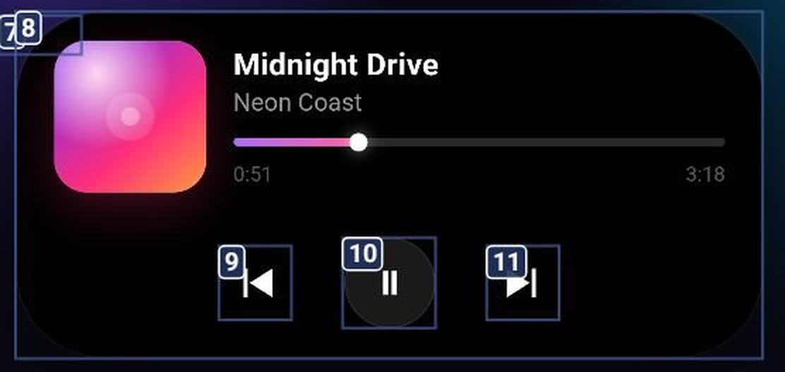

# Island — Dynamic Island for Android

A floating live-activity pill for the **Google Pixel 7 Pro**: it lives around the
front camera, shows calls, timers, transfers and media, and expands into an
interactive card without leaving the app you're in.

This repo contains the working Android app, the single-file web prototype it
started from, and the iOS/ActivityKit specs written along the way.

**Latest release:** [v3.7](https://github.com/Logane228/dynamic-island/releases/latest) · **Repo:** <https://github.com/Logane228/dynamic-island>



## What's inside

| Path | What |
| --- | --- |
| `android/` | The Android app (Java, no Gradle, `aapt2 + javac + d8 + apksigner`), build script included |
| `index.html` | Single-file web prototype of the island (open it in a browser) |
| `ios-dynamic-island/` | iOS Live Activity architecture: gestures, multi-tasking, ActivityKit, SwiftUI |
| `ios-call-activity/` | Minimal, production-shaped `CallActivityAttributes` + widget + intents |
| `ios-call-concept/` | Interactive web concept of the call island (compact / expanded / split) |
| `android-multitask/` | Android architecture for up to 3 concurrent activities, edge anchoring, Compose gestures |
| `fr-capsule-pixel7/` | French spec: capsule around the Pixel 7 Pro punch-hole, Material You, Compose |

## Android app

**Features**

- Capsule around the punch-hole (accessibility overlay so taps work over the
  status bar), or pinned below the bar, or anchored to the left/right edge for
  punch-hole / secondary-display layouts.
- Live activities: call (waveform + timer + mute / route / end), 5-minute timer,
  message cards, charging animation, and any app's progress/chronometer
  notification.
- Tap → quick panel or expand; long-press → expand; swipe ←/→ → rotate between
  concurrent activities; swipe ↑ → collapse; drag → reposition (when unlocked).
- Secondary bubble for the next activity, tap to swap it into focus.
- In-app call screen reached from the expanded card.
- Position lock, presets, Material You accent colours.
- **iOS-style notification centre**: big clock + uppercase date, *Notifications*
  header with ✕, per-app glass stacks with a count pill (tap to expand),
  long-press to dismiss one, tap to open the app. Opened by a top swipe on the
  home screen or from Island settings.
- **Launcher search**: live app filter in a glass search bar; while searching the
  widget hides and the grid shows matches.
- **Smart notification routing**: island shows *Tout / Messages / Off*, dedupes
  repeats, never covers a running call; WhatsApp senders are counted to pick the
  "frequently contacted" favourite for the quick-call widget (call-log fallback,
  contact-picker override).
- **Liquid-glass home screen**: the app registers `CATEGORY_HOME` and can be the
  default launcher — parallax mesh wallpaper, two swipeable pages, glass quick-action
  widget (call / repo / Wi-Fi), 4-column app grid, dock, `Aa` grayscale toggle,
  long-press jiggle mode with `−` badges to hide apps.
- **Control Center**: swipe down on the capsule for a panel with torch toggle,
  Wi-Fi panel, Bluetooth settings, brightness and media-volume sliders.
- **Charging animation picker** in the app: *Orb* (liquid glass, Siri wave),
  *Ribbon* (orbiting particle ribbons), *Bolt* (icon card), *Pill* (compact ⚡ +
  %), or *Off* — tapping a style previews it instantly.
- Charging animation with a **liquid orb**: dark glass sphere, three iridescent
  Siri-wave bands, rim light and specular, percentage inside — plays when the
  charger is plugged in (Canvas approximation of the Metal orb shader).
- Iridescent "liquid glass" glow around the capsule border — three pastel
  sweep gradients rotating at different speeds, inspired by the Siri-wave orb
  (replaces the flat RGB ring as of 3.8).

**Build**

```bash
cd android
./build.sh          # → android/island.apk
```

Needs an Android SDK (`ANDROID_SDK`, default `/root/opt/android/sdk`) with
build-tools 34 and `platforms/android-34`. The APK is not committed; build it.

**Install**

Sideload the APK, then grant:

| Permission | Why |
| --- | --- |
| Display over other apps | the overlay itself |
| Notification access | message cards, media, live activities from other apps |
| Accessibility service | lets the capsule receive taps while it sits on the camera |

The accessibility shortcut can be switched off afterwards — the service stays on.

## Web prototype

```bash
python3 -m http.server 8099
# open http://127.0.0.1:8099/index.html
```

States: idle, music, timer, call, charging, message. Tap to expand, tap the
triggers in the dock.

## iOS specs

They describe Apple's real constraints — tap routes via `widgetURL`, long-press
is system-owned, no swipe inside the island — and give SwiftUI / ActivityKit code
for the legal version of each idea.

## Limits

- The Android app renders one pill at a time and rotates focus; simultaneous
  three-window rendering is specified in `android-multitask/` but not shipped.
- Audio routing and the call itself are simulated — this is the island UX layer.
- The foreground service needs a notification; it is minimised but cannot be
  removed by Android design.
- iOS code is hand-written against the iOS 17/18 SDKs and has not been compiled
  in this repo.

## License

No license file yet — add one (MIT is the usual choice) before publishing.
